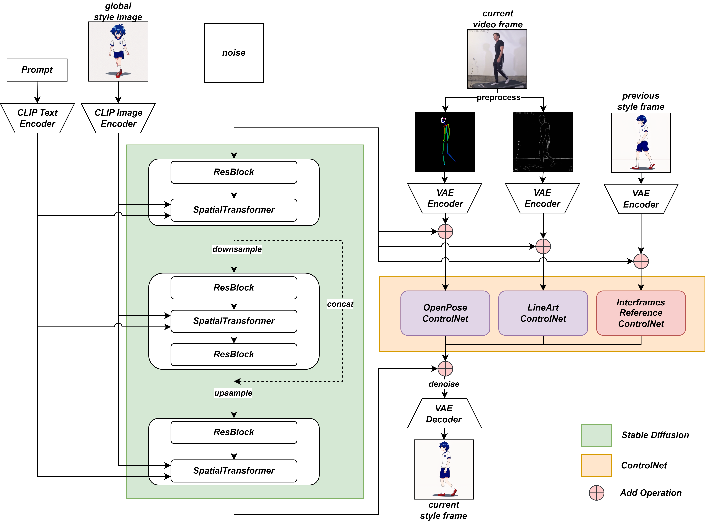

# sd-webui-animed-video-controlnet
An sd-webui extension plugin for controllable anime video generation (In Development)

## Core Principle
Stable Diffusion + ControlNet (multiple)

- stable diffusion model: anything v5
- controlnet_1: openpose
- controlnet_2: lineart
- controlnet_3: interframes_reference_controlnet (a reference control network for inter-frame consistency, trained by myself)

## Features
- Input: One reference anime character image + One real-person action video
- Output: An anime character action video

## Usage
- Install sd-webui
- Install the sd-webui-controlnet extension
- Install this extension

## Demo Video

[demo.mp4](demo.mp4)
